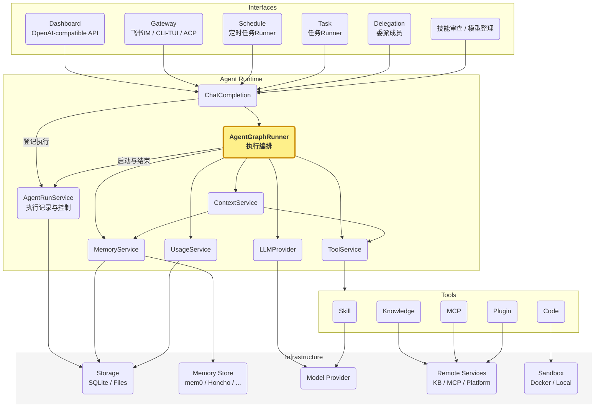
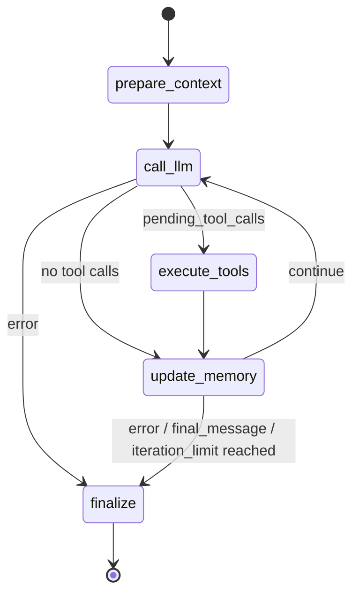
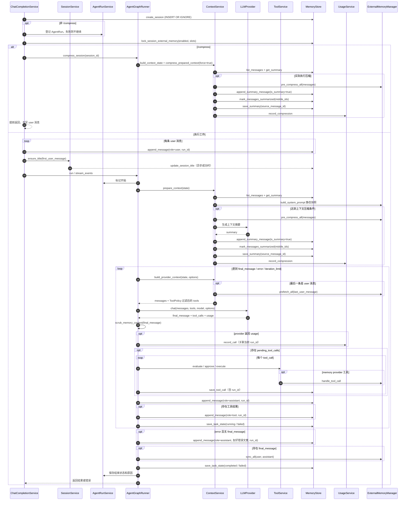
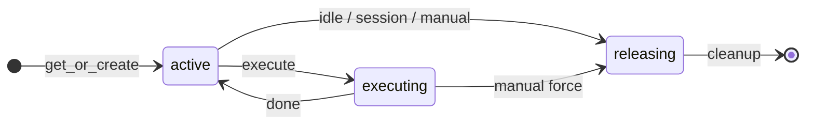
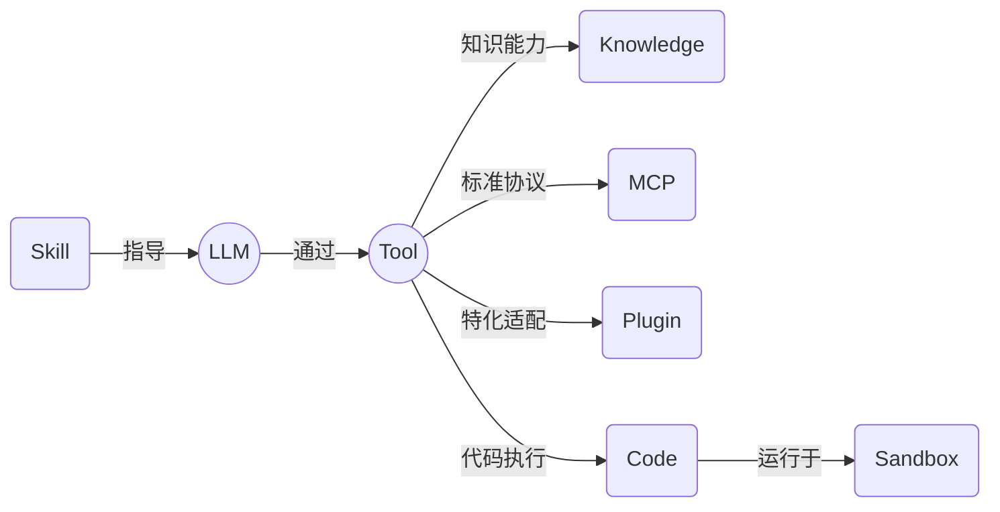
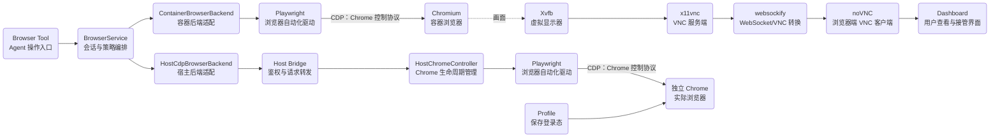
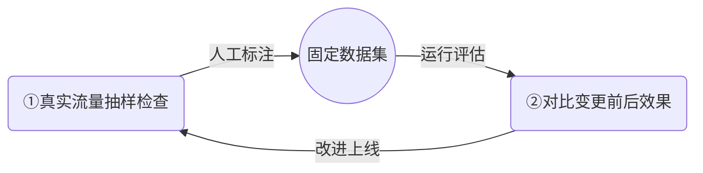

本文介绍自研通用 Agent Runtime [N-Agent](https://github.com/niean/n-agent)。N-Agent 支持对话、任务、定时任务等功能，以 Session（会话）为核心业务模型，以 AgentRun 表达一次执行，用 LangGraph 编排模型和工具调用，用领域驱动设计（DDD）隔离业务核心与外部实现。

核心流程：用户对话、后台任务、或定时任务自动触发后，N-Agent 创建或复用 Session，登记 AgentRun，准备上下文，循环“调用模型 → 按需执行工具”，直至本次执行结束；会话与外部记忆按策略更新，结果可同步或流式返回。


## 领域划分

```text
Agent Runtime
├── 核心子域
│   ├── Session：会话身份与生命周期，串联消息、摘要与执行记录，为 Agent 执行提供会话上下文归属边界
│   ├── AgentRun：一次 Agent 执行的记录、控制与编排，包括上下文准备、模型和工具调用、结果保存
│   ├── Context：组装模型输入视图，包括基础消息上下文、约束过滤后的工具定义等
│   ├── LLM：模型交互子域，负责Provider Request(请求)构造、模型调用、响应解析
│   ├── Memory：会话记忆与跨会话外部记忆的保存、更新和检索
│   └── Tool：工具契约与执行编排，把模型 tool_calls 转换为受控的工具执行
├── 支撑子域
│   ├── Schedule：定时任务定义、调度、租约执行与结果投递
│   ├── Task：目标型后台任务的状态、调度、执行、审批与产物
│   ├── Artifact：制品内容、版本、预览、编辑、导出与发布
│   ├── Delegation：把工作分给多个 Agent，并汇合结果
│   ├── Knowledge：KB的SPI定义、实例管理，通过search_knowledge检索知识
│   ├── MCP：MCP site 注册与工具同步，把远程 MCP server 工具暴露给 LLM 调用
│   ├── Plugin：本地插件包扫描、启停、配置和工具动态注入
│   ├── Skill：本地 SKILL.md 包的读写、审批、自进化与周期维护
│   ├── Sandbox：受控代码执行子域execute_code(Python)、terminal(Shell)
│   ├── Host Terminal：经宿主 Bridge 和独立 Policy 授权的本地命令执行
│   ├── Browser：浏览器会话、操作、接管与宿主/容器双后端
│   ├── Gateway：统一飞书、CLI/TUI、ACP 的交互消息、入口会话、命令与确认，并路由至ChatCompletionService
│   ├── Platform：飞书等外部消息平台抽象，生命周期管理
│   ├── Config Bundle：跨机器搬运配置的打包与幂等导入，只含配置不含任何运行时数据
│   ├── Evaluation：真实流量抽样检查、人工标注回流数据集与变更效果对比
│   └── Usage/Observation：模型用量、成本、上下文构成与压缩收益观测
├── Shared Kernel
│   └── Policy：通用决策契约
└── 外部边界
    ├── Storage
    └── Model Provider
```

系统核心模块，如下：



## Session

Session 是N-Agent的核心业务模型，负责串联消息、摘要和执行记录。当前所有 Agent 执行都必须归属一个 Session，包括对话、后台任务、定时任务。

- 对话：同一会话的多轮交互复用 Session，每轮执行各有一条 AgentRun 记录。
- 后台任务：任务可以先独立创建；执行时优先使用指定会话，其次复用来源对话的会话，否则自动创建该任务专用的会话，后续执行继续复用。
- 定时任务：创建时绑定 Session，通常自动创建专用会话，也可按规则绑定指定会话；每次触发执行都使用绑定的会话。

除对话外，对于后台任务、定时任务等，用户无需显式创建Session，系统会自动创建或复用。


## AgentRun

AgentRun 记录 Agent 的一次执行：谁触发、做什么、是否完成、为何结束。系统可查询或取消执行；子执行和重试各有独立记录。对话中的一个轮次Turn，底层就是一次AgentRun。

执行过程如下：



执行时序如下：`ChatCompletionService.complete` → `AgentGraphRunner`（LangGraph.Graph.StateGraph）。图中 Memory 表示经 RuntimeMemoryService 访问 MemoryStore；消息、工具及用量仅在允许保留时写入。`/compress` 只压缩上下文，不启动 AgentRun。




## Context

Context 子域负责模型调用前的运行视图组装。prepare_context 准备基础消息上下文，包括 system prompt、历史消息/摘要(动态压缩)、本轮用户输入；每次 call_llm 前，再由 build_provider_context 生成本次 Provider Context。

```text
Context Frame
├─ 1. System Prompt
│  ├─ 身份 identity / 指令 instruction / 安全约束 safety
│  ├─ 技能 skills index
│  └─ 外部记忆-静态快照：已启用 provider 的 system_prompt_block
│
├─ 2. Session Context
│  └─ ConversationMessage：head + latest summary + tail
│     └─ compression：历史消息滚动压缩，最新摘要latest summary
│
├─ 3. Run Context
│  ├─ 本次 input messages
│  └─ 外部记忆-动态检索：call_llm 前 prepend 到 本轮用户输入user message
│
├─ 4. Tool Context
│  └── tool schemas：工具描述，经工具策略 ToolPolicy 过滤
│
└─ 5. Execution Context
   ├─ run options
   │  ├─ external_memory_enabled：选择外部记忆来源
   │  └─ tool_exposure_policy：选择可见 tool definitions
   └─ ToolExecutionContext：工具授权、trusted_metadata、execution_context_mode

       │ ContextService 组装
       ▼

ProviderContext
├─ messages ← 1 + 2 + 3
└─ tools    ← 4

AgentGraphRunner 再组合 ProviderContext + model + options，调用 llm_provider.chat(...)
```


<details markdown="1">
<summary>对话示例</summary>

```text
前提
├─ input_messages: [user("我叫什么，最喜欢什么水果？顺便打印下 UTC 时间。")]
├─ external_memory_enabled: ["file_memory_1", "mem0"]
├─ file_memory_1 静态快照: "所有回复以‘外部记忆1：’开头。"
├─ mem0 已存事实:
│  ├─ "用户名是 niean"
│  ├─ "最喜欢的水果是西瓜"
│  └─ "偏好简洁回复"
└─ tools: [get_current_time, ...]

prepare_context
└─ working_messages
   ├─ system(identity / instruction / safety / skills index /
   │        file_memory_1 静态快照 / mem0 system_prompt_block())
   └─ user("我叫什么，最喜欢什么水果？顺便打印下 UTC 时间。")

call_llm #1
├─ 外部记忆-动态检索：prefetch_all()，返回:
│  └─ <memory-context>
│     └─ <provider name="mem0">
│        └─ ## Mem0 Memory
│           ├─ 用户名是 niean
│           ├─ 最喜欢的水果是西瓜
│           └─ 偏好简洁回复
├─ 将 <memory-context> 临时 prepend 到最后一条 user message
├─ ProviderContext.messages: [system, user(memory-context + input message)]
├─ ProviderContext.tools: [get_current_time, ...]
├─ llm_provider.chat(...)
└─ LLM 返回 tool_calls: [get_current_time]

execute_tools
└─ ToolCall: 保存 get_current_time 执行审计

update_memory #1
└─ ConversationMessage:
   ├─ assistant(tool_calls)
   └─ tool(result)

call_llm #2
├─ working_messages: [system, user, assistant(tool_calls), tool(result)]
├─ llm_provider.chat(...)
└─ LLM 返回 final_message:
   └─ assistant("外部记忆1：你叫 niean，最喜欢西瓜。当前 UTC 时间是……")

update_memory #2
├─ ConversationMessage: 追加 assistant(final_message)
└─ TaskState: 保存 running 状态

finalize
├─ ExternalMemoryManager.sync_all(...):
│  └─ agent_context="primary" 时，mem0.sync_turn() 同步本轮 user/assistant 消息
└─ TaskState: 保存 completed 状态
```
</details>


## LLM

LLM 子域对应 `call_llm` 节点，负责一次模型交互，不负责工具执行或记忆写入。

```text
LLM
│
├── Provider Request
│     ├── provider context：messages / tools (由 Context 子域组装)
│     ├── model
│     └── options
│
├── Provider Call
│     └── llm_provider.chat(...)
│
└── Response Parse
      ├── final_message
      ├── pending_tool_calls
      ├── finish_reason
      ├── usage
      └── next_step
```


## Memory

Memory 有两条持久化边界：会话记忆保存当前 session 的运行事实，外部记忆保存跨 session 知识。

`ConversationSession` 是 Session 的聚合根，当前会话及关联记忆通过 `MemoryStore` 持久化。

```text
Memory
├─ 会话记忆: MemoryStore → SQLiteMemoryStore
│  ├─ ConversationSession: source / title / external_memory_enabled / slots / ACP metadata
│  ├─ ConversationMessage: user / assistant / tool / is_summary / is_summarized
│  └─ ToolCall / TaskState / Summary
└─ 外部记忆: ExternalMemoryProvider → ExternalMemoryManager → Provider Adapter
   ├─ builtin: Markdown + trust metadata + observations
   ├─ multi-project: 多目录 Markdown
   └─ external-query: mem0 / holographic / honcho，全局至多一个 active
```

| 槽位 | 实现 | 存储与写入 |
|------|------|-----------|
| builtin | `BuiltinProjectMemory` | `{memory,user,observations}.md` + `memory.meta.json`；`sync_turn` 追加观察 |
| multi-project | `MultiProjectMemory` | 每个项目一组 `{memory,user}.md`；`sync_turn` 为 no-op，只由工具写入 |
| external-query | `Mem0Adapter` | HTTP 事实库 |
| external-query | `HolographicAdapter` | 本地 SQLite；`MemoryRetriever` 使用 Jaccard + 词频检索 |
| external-query | `HonchoAdapter` | HTTP workspace / peer / session context |


## Tool

Tool 子域定义 Agent 可发现、可调用的能力契约，并把 LLM tool_calls 转换为受控执行。它不实现 Knowledge、MCP、Plugin、Skill、Sandbox 等具体能力。

```text
Tool
├─ Application：ToolService 管理工具定义、模型暴露、执行编排
├─ Domain
│   ├── ToolDefinition：工具定义，主要是能力描述，不包含 handler
│   ├── ToolCallRequest：调用请求，包含 id、name、arguments
│   ├── ToolPolicy：执行管控，治理工具的校验、暴露、执行、审批要求
│   ├── ToolExecutionContext：执行上下文，携带授权和可信运行信息，仅限本次执行
│   ├── ToolExecutor：执行接口，定义SPI，具体实现属于各支撑子域或 Infrastructure
│   └── ToolResult：执行结果，包含状态、内容和耗时
└─ Infrastructure：CompositeToolExecutor 按工具名路由到具体 ToolExecutor
```

一个工具可用需同时具备定义和执行路由：前者决定模型能否看到，后者决定调用能否落到具体实现。ToolService 是不可绕过的执行边界，执行前会按当前定义复判。

```text
ContextService 通过 ToolService 生成可见 tool definitions
  -> LLM 返回 tool_calls
  -> AgentGraphRunner 构造 ToolCallRequest
  -> ToolService 查找 ToolDefinition，调用 ToolPolicy 并生成 PolicyDecision；需要审批时，AgentGraphRunner 根据决策发起审批、取得执行授权
  -> ToolService 执行前复判 ToolPolicy
  -> ToolExecutor 执行具体能力
  -> ToolResult 作为 role=tool 消息回流 LLM
```


## Sandbox

Sandbox 子域为模型提供受控执行环境，承载 `execute_code`（Python）与 `terminal`（Shell）。两者均为 `RiskLevel.SAFE`工具，Docker 是生产安全边界、不走审批。

所有入口统一经过 ToolService，并按工具路由到独立 Executor：

```text
Interface/Gateway -> ChatCompletionService -> AgentGraphRunner.execute_tools
  -> ToolService.execute
       ├─ execute_code -> SandboxToolExecutor
       │    └─ 会话锁 -> get_or_create -> per-call staging -> Sandbox.execute
       └─ terminal -> TerminalToolExecutor
            └─ 会话锁 -> get_or_create -> 校验 workdir -> Sandbox.exec_command
  -> SandboxExecutionHistoryRegistry
  -> ToolResult 回流 AgentGraph，写 role=tool 消息
```

<details markdown="1">
<summary>生命周期</summary>

`SandboxManager` 按 session 懒创建并串行执行。空闲到期或 session 删除时协作释放；Dashboard 可强制释放。Docker 启动时还会清理上次进程遗留的孤儿容器。


</details>


<details markdown="1">
<summary>安全边界</summary>

- Docker：workspace 只读、scratch 可写，默认禁网，并限制 CPU、内存、进程与临时目录。
- `execute_code`：外部能力仅能通过 UDS RPC callback tools 获取，并受 allowlist、调用次数与超时约束。
- `terminal`：不使用 callback tools；workdir 仅允许 scratch/workspace，workspace 仍只读。非零退出码表示命令执行失败，但工具状态仍为 SUCCESS；仅超时或执行异常映射为 TIMEOUT/ERROR。
- 审计：两类执行都持久化 code_hash、状态、结果和 `execution_type`；Sandbox 异常转为 `ToolResult(ERROR)`，不打断 AgentGraph。
</details>


## XUI

N-Agent 用户入口类型，有如下几类：

| 入口  | 传输+编码协议 | 适配器 | 应用层 | 适配器源文件 |
|:-----|:------------|:------|:------|:-----------|
| Dashboard 管理 API | HTTP+JSON | create_*\_router / register_*\_routes | 查询和管理，不启动 AgentRun | app/interfaces/http/ |
| OpenAI 兼容对话 API | HTTP/SSE+JSON | create_openai_compatible_router | ChatCompletionService | app/interfaces/http/openai_compatible.py |
| 飞书 IM 长连接 | WebSocket+JSON | FeishuImAdapter | GatewayService → ChatCompletionService | app/interfaces/feishu_im_adapter.py |
| TUI/CLI Chat | Stdio+行式文本 | CliChatAdapter | GatewayService → ChatCompletionService | app/interfaces/cli/ |
| ACP Agent | Stdio+JSON | NAgentACPAgent | GatewayService → ChatCompletionService | app/interfaces/cli/commands/acp/ |
| 定时任务执行 | - | SchedulerRunner | ScheduleRunService → ChatCompletionService | app/application/scheduler_runner.py |
| 任务执行 | - | TaskRunner | TaskRunService → ChatCompletionService | app/application/task_runner.py |
| Skill 周期维护 | - / Stdio+行式文本 | 空闲周期检查 / CLI Curator 命令 | SkillCuratorService；模型整理时经 SkillEvolutionService → ChatCompletionService | app/application/skill_curator_service.py；app/interfaces/cli/commands/curator.py |

其中，

- 管理 API 不启动 AgentRun；
- OpenAI 兼容对话 API 直接进入 ChatCompletionService；
- 飞书 IM、TUI/CLI、ACP 的用户消息先经 GatewayService 统一做入口会话、消息管理，再进入 ChatCompletionService。
- ACP协议生命周期保留在 NAgentACPAgent 中。
- 定时任务执行由 SchedulerRunner 定时触发，并通过 ScheduleRunService->ScheduledAgentExecutor 直接调用 ChatCompletionService，执行结果再由 ScheduleOutboundDelivery 投递。
- 任务执行由 TaskRunner 触发，并通过 TaskRunService->TaskAgentExecutor 直接调用 ChatCompletionService。
- Skill 周期维护在满足空闲与维护周期条件时触发，也可由 CLI 手动运行；根操作为 `curator.run`。规则维护本身不启动 AgentRun；启用模型整理且存在候选技能时，复用 SkillEvolutionService，使用独立的 `curator-…` 会话，形成 `curator.run → skill.review → invoke_agent`，来源为 `curator`。


---
---
以下是一些概念澄清、技术要点。

## 产品形态

对话处理用户消息，定时任务按计划工作并投递结果，后台任务通过任务状态机组织目标执行。它们都可调用 AgentRun，任务还可多次执行并汇总结果与 Artifact。

```text
①对话：
用户提问 → AgentRun → 回复消息

②定时任务 Schedule：
定时触发 → AgentRun → 结果投递

③任务 Task：
提交目标 → Task → TaskRun → 一个或多个 AgentRun → 汇总 + Artifact
```

TaskRun 记录一次任务尝试，其中可多次调用 Agent 处理或检查结果。对话中的 AgentRun 也可通过工具创建 Task，交给后台执行。

## 工具概念
- Skill：结构化Prompt，指导LLM怎么想、怎么说，进而完成功能。Skill定义**业务逻辑**，主决策而非执行，这是和其它工具的区别
- Plugin：特化工具为LLM定制的点对点适配，将外部工具能力、封装为LLM可调用函数FC/Tool；Plugin是本地部署的工具适配层，而非工具本身
- MCP：面向LLM的标准协议，用于统一外部工具、资源、上下文的访问方式，类似总线协议。站在LLM领域看，**MCP是SPI、Plugin是Adapter**




## 消息压缩

消息压缩属于 Context 子域，用于在模型上下文过长时保留开头和最近消息，并把中间可压缩消息滚动归并为摘要。默认形态：`head 3 + latest summary + tail 10`，`latest summary = llm_summary(last summary + middle)`。

```text
ConversationMessage + Summary
  -> ContextService.prepare_context 读取会话消息和 latest summary
  -> ContextPolicy 判断是否需要压缩，生成 CompressionPlan(head_n / tail_n / target_ratio)
  -> ExternalMemoryManager.pre_compress_all 抢救待压缩消息中的外部记忆线索
  -> ContextCompressor 按 head + middle + tail 切分；middle 与上次摘要一起生成新 summary
  -> 结果写成 head + latest summary + tail，避免把摘要追加到末尾
  -> MemoryStore 依次 append_summary_message -> mark_messages_summarized -> save_summary
  -> UsageService 记录压缩前后 token 与摘要观测
```


## Skill自进化

Skill 自进化是 Agent Runtime 对会话摘要的后台审查，把可复用、非平凡工作流沉淀为受治理的技能。每隔N轮对话触发1次自进化审查。

前台 AgentRun 在 finalize 阶段满足开关、间隔和并发条件时，SkillEvolutionService 经 ChatCompletionService 异步启动独立的审查 AgentRun，技能修改仍受 SkillPolicy 管控。

审查复用原对话的 `session_id`，设置 `persist_messages=False`，不保存审查消息，也不改变原会话来源。因此它没有单独的 XUI 入口或会话筛选类型。

审查根操作为 `skill.review`，根操作与内部 AgentRun 的观测来源均为 `skill_review`，通过 Span Link 关联触发它的前台执行。`skill_view` 是审查可调用的工具，修改已有技能前须先读取目标。

```text
会话摘要 digest
  -> SkillEvolutionService 按 nudge_interval 后台触发 maybe_trigger(session_id, turn_count, digest)
  -> 以 SkillWriteOrigin.BACKGROUND_REVIEW fork 审查 Agent，仅暴露 skills_list / skill_view / skill_manage
  -> 审查摘要是否值得持久化；修改已有 Skill 前必须 skill_view 读取目标
  -> SkillService.manage_skill 统一写入口和规范；SkillPolicy 判定 allow / require_approval / deny
  -> 通过 SkillFileLoader 写入 SKILL.md，并由 SkillRegistry / SkillUsageRegistry 记录可见性与使用事实
  -> 下轮 Context 的 System Prompt 注入 skills index；LLM 再通过 skills_list / skill_view 加载具体 Skill
```

## 安全策略

任务子域安全策略与配置按可配置性分三类（权威定义见 .harness/knowledge/03-conventions.md "任务安全策略分类"）：

- A 类 安全不变量（只读，禁止配置）：任务状态机/claim 契约/断路条件逻辑、Worker 安全（工具剥离/Judge 只读/token 不透明/入口来源/执行模式）、审批安全（会话隔离/存在性不泄漏/revise 必填/未知字段拒绝）
- B 类 启动期绑定（env-only，改需重启）：task_enabled、task_dispatch_interval_seconds、task_shutdown_grace_seconds
- C 类 运行时可配（Dashboard 可编辑 + 热重载）：并发/租约/心跳/运行时长/目标轮次/附件限额/失败上限/note 上限，经 TaskConfigProvider 热重载，SQLite task_config 单行逐字段覆盖

本地 Shell：terminal 工具在 Sandbox 子域执行（workspace 只读、scratch 可写、workdir 仅允许 scratch/workspace），详见 ## Sandbox 章节；host_terminal 走宿主子域独立 Policy。

## Browser Use
浏览器自动化，可选后端包括容器、本地CDP。

- 容器：Playwright 通过 CDP 控制容器内 Chromium；Xvfb/noVNC 把同一画面送到 Dashboard，Agent 和人操作同一个页面。
- 本地 CDP：N-Agent 请求宿主 Bridge；Bridge 验证授权后启动并控制独立 Chrome。专用 Profile 保留登录态，不影响日常 Chrome。



## Artifact

Artifact 支撑域统一管理 Agent 产出或用户提交的长文本和文件，包括内容、版本、预览、编辑、导出与发布。

```text
Agent 判断内容适合保存为制品
-> 调用 artifact_create，提交名称、类型，以及内容或文件引用
-> 系统从当前上下文补充会话、运行和创建人信息
-> ArtifactService 校验内容，计算大小和 SHA-256
-> 保存内容，并同时创建制品及首个版本
-> 制品工作台提供预览、编辑、导出和发布
```

制品会关联来源和会话，可预览、编辑、导出和公开发布。Task 产物和附件也会自动登记为制品。

每次改内容都会留下历史版本，可比较或回退；改完已发布内容后，重新发布才会更新公开内容。

发布会生成独立快照。删除源制品不会删除已发布的快照；撤销发布会使公开链接失效。


## 多Agent委派

父 Agent 可通过 `delegate_agents` 把工作拆给多个子 Agent，并等待结果返回。

```text
父 Agent 调用 delegate_agents
  -> 校验服务端授权、子任务、工具、预算和超时
  -> 按 delegation_key 创建或接回同一批委派
  -> 子 Agent 在隔离会话中以各自的 AgentRun 并行执行
  -> 按 join_policy 汇合结果
  -> 脱敏后作为 ToolResult 返回父 Agent
```

多Agent委派入口，包括实时对话、Task worker。多Agent委派禁止递归，只支持一层；子 Agent 看不到父会话，也不能继续委派、审批任务或使用管理写工具。


## Evaluation评估

评估子域有两个作用：

- ①对真实流量抽样检查，发现回答、检索或任务执行中的质量问题。
- ②用固定数据集，对比变更前后的效果，判断改动是否有效、是否引入退步。

真实流量中的样本，经人工标注与审核后可沉淀为数据集。后续更换模型、修改提示词或检索策略时，用同一版本数据集和评分标准分别评估变更前后；根据结果改进并上线，再继续抽样检查。




## 观测设计

观测解决四件事：做了什么、为何结束、哪里慢、消耗多少。各类观测信号，分布如下：

| 信号 | 打点位置与内容 | 核心组件 |
|---|---|---|
| Trace | Agent 开始到结束记一段；每次模型调用、工具执行、上下文压缩各记子段，保留父子关系 | Tempo |
| Metric | 执行或调用结束时记次数、耗时、Token、失败；另记压缩和预算拒绝 | Prometheus |
| Log | 在结束、异常、拒绝等位置记原因，关联当前 Trace | Loki |
| Profile | 运行期间持续采样函数调用栈 | Pyroscope |

Trace、Metric、Log 的结构和关联方式沿用 [OTel](https://opentelemetry.io/docs/concepts/signals/)，通过 OTLP 发给 Collector 收集转发；Profile 当前独立上传。统一用Grafana做报表展示。

从执行记录可以查找相关 Trace，追踪这次工作的模型和工具调用。

观测信号的字段规范，分为三类 OTel通用、GenAI草案、项目特化：

- OTel 通用字段：`service.name/version/instance.id` 标识服务；Trace 的 `trace_id/span_id`、父段、起止时间和状态串起执行；Log 记录时间、级别、正文及当前 Trace/Span 标识。
- [OTel GenAI 约定](https://opentelemetry.io/docs/specs/semconv/gen-ai/)：`gen_ai.operation.name` 区分 `invoke_agent/chat/execute_tool`；`gen_ai.agent.name`、`gen_ai.conversation.id` 标识 Agent 和会话；模型调用记录 `gen_ai.provider.name`、`gen_ai.request.model`、`gen_ai.usage.input_tokens/output_tokens`、`gen_ai.response.finish_reasons`；工具记录 `gen_ai.tool.name/call.id`。斜线表示同前缀的多个字段。GenAI 约定仍在演进，项目固定采用版本。
- N-Agent 特化：`nagent.run_id/source/iteration/end_reason` 记录运行、入口、轮次和执行结束原因；`nagent.policy_outcome` 记录策略结果；`nagent.before_tokens/after_tokens` 记录压缩前后用量。OTel 已覆盖的含义不另起名字。

打点实现，节选样例如下（`app/application/telemetry_semantics.py`，省略非关键代码）：

```python
# 模型调用：进入时创建子段，退出时结束，异常标记为失败。
span = _start_span(chat_span_name(model), SpanKind.CLIENT)
_set_attr(span, GEN_AI_OPERATION_NAME, operation)
_set_attr(span, GEN_AI_REQUEST_MODEL, map_model_name(model))
try:
    with _span_scope(span):
        yield span  # 调用方在这里执行模型请求
except BaseException as exc:
    _mark_span_error(span, exc)
    raise
finally:
    _end_span(span)
```

