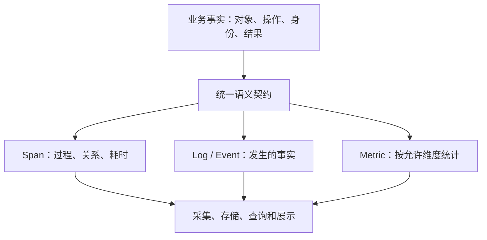
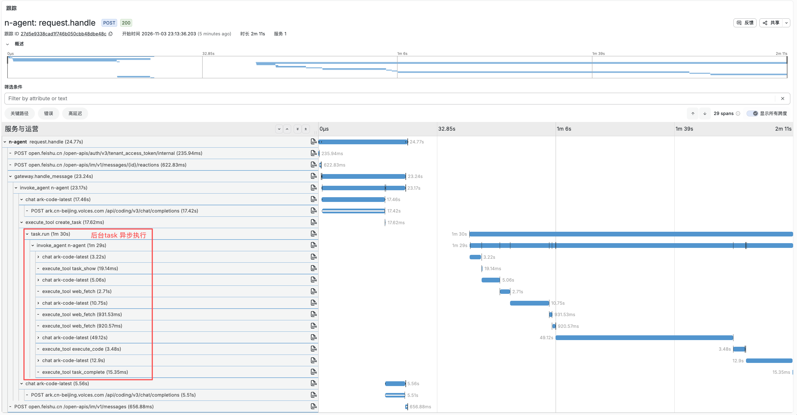
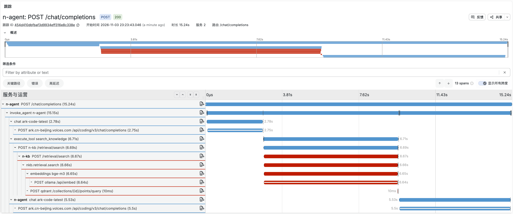

## 概述

Agent 可观测需要先统一业务语义，再落实到埋点与平台。本文以 [N-Agent](https://github.com/niean/n-agent) 为例，建立了一套观测语义契约 O11y Semantic Contract，说明如何定义对象、操作、属性、事件、状态、结果和身份，让 Trace、Log、Metric 使用同一套解释；同时明确指标计数、异步关联、内容脱敏、故障隔离的边界。结尾附完整语义表。

## 导读

做 Agent 可观测，需要回答几个问题：用 OpenTelemetry 还是 Langfuse，它们各负责什么？模型调用、工具调用、安全检查，分别应该怎么记录？

后台任务、委派、上下文压缩和多种消息入口，还需要回答共同的业务问题。

同一个 `run_id`，到底指 Agent 的一次运行，还是后台任务的一次运行？工具被策略拒绝，算失败，还是算一次正常完成的安全检查？飞书请求提交了后台任务，后面 Agent 的来源应该记飞书，还是记 Task？为什么 Trace 看到了两次调用，指标却统计出了四次？

这些问题需要先统一业务含义，再落实到埋点和查询。本文记录我在 N-Agent 中采用的设计：让对象、操作、属性、事件、结果和身份形成一套共同约定，贯穿 Trace、Log 和 Metric。

这是一份项目实践。文中的 `nagent.*` 字段、对象划分和结果枚举属于 N-Agent 的选择；引用 OTel 的部分会单独说明。

## 概念

为了减少交流成本，我把观测设计拆成以下几个问题。

| 概念 | 要回答的问题 | 例子 |
|---|---|---|
| 信号 Signals | 用什么数据看系统？ | Trace、Log、Metric、Profile |
| 对象 Objects | 观察谁？ | Agent、模型、工具、任务、请求 |
| 操作 Operations | 对这个对象做什么？ | 调用模型、执行工具、运行任务 |
| 属性 Attributes | 这次操作有哪些具体事实？ | 模型名、工具名、来源、结果 |
| 事件 Events | 某个时刻发生了什么？ | 策略作出决定、工具处理结束 |
| 状态 State | 对象现在处于哪一步？ | 运行中、等待审批 |
| 结果 Outcome | 本次操作怎样结束？ | 成功、拒绝、取消、超时 |
| 身份 Identity | 属于哪次运行、哪个任务、哪条链？ | AgentRun ID、TaskRun ID、Trace ID |
| 指标 Metrics | 如何统计多次操作？ | 运行次数、耗时分布、Token 用量 |

其中，信号提供不同的观察方式。OTel 的信号概念可参考[官方说明](https://opentelemetry.io/docs/concepts/signals/)。本文主要讨论 Trace、Log 和 Metric 如何共享业务含义。

以一次 `read_file` 工具调用为例：对象是工具，操作是 `execute_tool`，工具名是属性；处理结束后可以产生完成事件，结束结果可能是 success，也可能是 denied。Span 记录过程和耗时，Log 记录当时的事实，Metric 统计这类处理发生了多少次、耗时怎样分布。

这里的“共享”需要有边界。工具调用 ID 可以进入 Span 和日志，用于查找单次调用；指标只选取工具名等受控维度，用来聚合统计。



这张图也是我希望维持的依赖方向：查询和大盘使用采集端已经明确的含义，尽量减少在查询语句里重新猜测业务。

## 对象

假设用户从飞书提交一个后台任务，任务里的 Agent 调用模型，模型再请求读取文件。

```text
飞书请求
└─ 提交 Task
   └─ TaskRun：后台运行
      └─ AgentRun：一次 Agent 运行
         ├─ chat：一次模型请求
         └─ execute_tool read_file：一次工具请求
            └─ 策略决定：允许、拒绝或需要审批
```

这是一条业务关系示意，具体 Span 层级由实际调用关系决定。策略决定通过 Log/Event 记录，图中不表示独立的策略 Span。

这里至少有请求、Task、TaskRun、AgentRun、模型、工具和 Policy 几种不同对象。把它们都塞进“operation”或“execution”这个大对象，字段名很快就会失去解释能力。

N-Agent 最终采用按对象归属命名的方式：

```text
nagent.<object>.<attribute>
```

例如：

| 字段 | 含义 |
|---|---|
| `nagent.agent.run_id` | 一次真实 Agent 运行的 ID |
| `nagent.task.run_id` | 一次后台任务运行的 ID |
| `nagent.request.channel` | 请求从哪个入口进入 |
| `nagent.agent.source` | 本次 Agent 运行由什么来源触发 |
| `nagent.tool.outcome` | 本次工具请求的处理结果 |
| `nagent.context.before_tokens` | 压缩前的上下文 Token 数 |
| `nagent.policy.outcome` | 本次策略决定 |

对象表达字段所描述的事实。工具 Span 可以携带所属 Agent 的 `nagent.agent.run_id`；这个字段仍然描述 Agent 身份，不会因为出现在工具 Span 上就变成工具属性。

前面的场景中，请求的 channel 是 `feishu`，后台 Agent 的 source 是 `task`。两者分别说明入口和直接触发来源，原始请求与后台任务通过任务身份和 Trace 关联。

这种拆分也让结果有了清楚的归属。模型返回成功，不代表工具执行成功；工具拒绝，也不必然代表整个 Agent 失败。每个对象记录自己范围内的事实。

## 操作
操作命名的原则：OTel标准优先，兼顾自定义。

OTel 的 GenAI 语义约定覆盖模型、Agent 等场景。[GenAI Semantic Conventions 仓库](https://github.com/open-telemetry/semantic-conventions-genai)包含 Span、Metric 和 Event 约定。

N-Agent 对已有合适标准的操作沿用标准名称，对项目业务操作补充自己的分类。下面展示项目当前采用的几个例子。

| 标准或自定义 | 操作名称 | 对象 | 表示什么 |
|---|---|---|---|
| 标准 | `invoke_agent` | Agent | 一次 Agent 运行 |
| 标准 | `chat` | 模型 | 一次模型请求 |
| 标准 | `execute_tool` | 工具 | 一次工具请求的处理 |
| 自定义 | `task.submit` | Task | 提交后台任务 |
| 自定义 | `task.run` | Task | 运行后台任务 |
| 自定义 | `context.compress` | 上下文 | 一次上下文压缩处理 |
| 自定义 | `delegation.run_member` | 委派 | 运行一个委派成员 |
| 自定义 | `request.handle` | 请求 | 处理一次入口请求 |

这张表只回答“做什么”。

落到数据上，项目把 `chat` 等标准操作写入 `gen_ai.operation.name`；自定义 `task.run` 的动作写为 `nagent.task.operation=run`，Span 名称使用 `task.run`。这是项目选定的组织方式，并不表示 OTel 禁止扩展操作值。

Span 名可以包含有助于阅读的受控目标，比如 `execute_tool read_file`。用户输入、任务 ID、会话 ID 不拼进名称，以免同一种操作产生大量不同名称。

HTTP 和数据库已有自动埋点的名称及协议属性，也沿用各自约定。例如 HTTP 请求入口可以在原有 SERVER Span 上补充请求事实，避免为了业务分类再套一层重复的入口 Span。

标准升级同样要纳入契约管理。项目文档记录的 GenAI 基线是 `main @ 2026-10-24 (Development)`；这个日期方便说明采用背景，但不够精确地复现规范。长期维护时，应进一步保存 commit、依赖版本和字段差异，再决定何时升级，不能让上游 main 的变化直接改变现有统计口径。

## 属性

属性可以被不同信号使用，但记录的位置和用途要分别设计。

| 位置 | 用来说明什么 | 适合记录的例子 |
|---|---|---|
| Resource 属性 | 数据来自哪个服务实例 | 服务名、版本、实例 ID |
| Span 属性 | 这一步操作的具体事实 | 工具名、模型名、所属运行 ID |
| Log / Event 属性 | 发生这件事时的现场 | 策略决定、结束原因、安全摘要 |
| Metric 数据点属性 | 这笔测量按哪些维度分类 | 模型名、操作分类、受控来源 |

Resource 可以理解为观测数据随附的服务身份信息：服务叫什么、运行哪个版本、具体是哪一个实例。它描述的是产生数据的服务资源。[OTel Resource 文档](https://opentelemetry.io/docs/concepts/resources/)对此有完整定义。

字段选择上，已有标准且含义适用的属性继续使用原名，例如 `service.name`、`gen_ai.request.model`、`gen_ai.tool.name`。项目补充事实使用 `nagent.*`。

同时，我给属性增加了类型和采集规则：ID 用字符串，计数用非负整数，耗时用有限非负数；未知值省略，类型错误的属性丢弃并记录安全诊断，业务继续运行。

一个很容易忽略的例子是 Token 用量。“没有获得用量”和“实际用了零个 Token”是两件事。把未知补成零，会直接拉低平均用量，也会让费用估算显得异常便宜。

因此，统一属性设计至少包含四部分：名称、含义、类型、允许出现的位置。只列一张字段名清单，还不足以形成可执行的约定。

## 结果
`completed` 只表示这次处理已经结束。

处理结束时，结果可以有多种。N-Agent 使用以下八类，方便跨对象查询：

| 结果 | 含义 |
|---|---|
| `success` | 本次操作按预期完成 |
| `failure` | 发生异常或明确失败 |
| `denied` | 权限、策略或预算拒绝 |
| `cancelled` | 有真实的取消事实 |
| `timed_out` | 有明确的超时事实 |
| `skipped` | 按规则跳过 |
| `deferred` | 本次处理结束，工作等待后续条件 |
| `unknown` | 无法确定结果 |

这套枚举是项目约定。其他系统可以选择不同分类，关键是每个值有稳定解释。

比如工具需要人工审批，当前 TaskRun 结束，Task 还在等待审批。此时可以同时记录：

```text
nagent.task.state = waiting_approval
nagent.task.outcome = deferred
nagent.policy.outcome = require_approval
nagent.tool.executed = false
```

四个字段分别说明任务状态、本次运行结果、策略决定和工具执行事实。把它们都压成 `status=failed`，后续就很难区分系统故障和业务流程。

完成事件同样按对象命名，例如 `nagent.tool.completed`；策略决定使用 `nagent.policy.decided`，预算拒绝使用 `nagent.budget.denied`。Log 和 Span Event 可以携带相同的完成事实，但它们是两种承载方式，消费端不能因此再统计两次业务操作。

对于自定义业务操作，项目将 failure、timed_out 标为 Span ERROR；拒绝、跳过、等待和取消保留各自含义，不自动归为技术错误。HTTP 等已有协议约定的 Span 继续遵循对应错误规则。这一映射应作为项目规则维护，不能直接推广为所有 OTel 埋点的统一规定。

## 链路

同步调用容易通过当前上下文建立父子关系，异步的后台任务更容易出问题：请求结束后，worker 可能已经换了线程、进程，甚至机器。

N-Agent 的方式是在任务创建时，将上游追踪上下文与任务记录绑定；worker 从自己领取的任务记录恢复上下文。每个 TaskRun 创建独立 Span，首次运行、重试和恢复沿用所属任务的上游 Trace。

身份仍然分别记录：

```text
Task ID       标识任务
TaskRun ID    标识本次后台运行
AgentRun ID   标识本次 Agent 运行
Trace ID      标识执行链
Span ID       标识链中的一步
```

它们之间有关联，但不能互相冒充。尤其不能在没有 AgentRun 的入口步骤上，拿 TaskRun ID 填进 `nagent.agent.run_id`，只为了让字段“看起来完整”。

也并非所有后台工作都需要延续一个 Trace。对于独立技能审查、周期性整理等工作，项目采用新 Trace 加 Link 的边界。选择取决于这次工作是否仍属于原来的调用过程，以及希望保留怎样的因果关系。

上下文传播还必须处理并发和退出：每个 worker 使用所属任务的上下文，操作结束后恢复现场，并行子任务隔离可变结果。否则，一条看似完整的 Trace 也可能把两个用户的任务串在一起。

## 指标

当 Span、日志和事件都有了，下一步很容易出现重复计数。

我的处理方式是让操作生命周期产生一次权威测量：结束时记录结果、测量耗时、写完成事实。Log 或 Event 后续被导出、转发时，不再额外增加业务计数。

每个指标需要写清楚以下内容：

| 项目 | 需要回答的问题 |
|---|---|
| 名称、类型、单位 | 累计次数，还是一次测量的分布？秒，还是毫秒？ |
| 触发点 | 请求开始、实际执行，还是处理结束？ |
| 统计范围 | 单次模型尝试、一次 AgentRun，还是整个任务？ |
| 允许维度 | 按模型、来源、工具名中的哪些维度分组？ |
| 缺失和边界情况 | 重试、零调用、拒绝、未知用量怎样处理？ |

在前面的例子中，模型失败后重试两次，就有多次模型尝试；AgentRun 结束仍只增加一次运行数。工具被拒绝，工具请求有处理耗时，但 `executed=false`，不会增加“实际执行工具数”。

这些区分直接影响大盘解释。例如，一次 AgentRun 没有调用工具，也要进入平均工具调用次数的分母。把零调用运行漏掉，面板展示的就变成了“调用过工具的 Agent 平均调用多少次”。

维度也要克制。N-Agent 允许部分 Agent 指标按受控 source 分组；会话 ID、运行 ID、用户输入不作为普通指标标签。排查单次执行时使用 Trace 和日志；指标到 Trace 的 exemplar 也只是部分测量的关联样本。

模型尝试、工具请求、Agent 汇总各有自己的范围，不能把父级汇总和子级用量再相加。业务费用则保留独立 Usage 账本作为依据，观测采样和导出故障不应改变计费事实。

## 约束

从契约到出口，还需要两道约束：内容治理、故障隔离。

第一道是内容治理。模型消息、工具参数、返回结果和异常文本，都可能包含敏感数据，也可能非常大。

N-Agent 把内容集中放在明确的内容字段中，先脱敏，再按字段限长，默认每项 2048 字节；同时保留截断、中断和已观察长度等元数据。完整长度未知时就省略，流式中断时保留已经安全处理的前缀。

出口使用精确字段允许集合，不能因为某个字段以 `gen_ai` 或 `nagent` 开头就自动放行。业务正文不进入 Metric、Profile 和自检缓冲。

第二道是故障隔离。语义契约定义固定对象、操作、属性类型、事件和指标；采集层管理生命周期；基础设施层负责 SDK 和导出；Collector 与 Grafana 按同一含义处理和查询。观测写入失败时隔离故障，同时保留业务原本的返回、异常和取消行为。

N-Agent 使用 OTel、Collector、Tempo、Loki 和 Prometheus 承载 Trace、Log、Metric，Grafana 展示；Profile 通过 py-spy 进入 Pyroscope；各组件使用同一套业务字段解释和统计口径。Langfuse 复用 OTel/Collector组件，业务字段做了映射。

## Langfuse

Langfuse 复用 OTel 和 Collector 接收现有业务事实。类型依据实际操作判定，定义见[官方文档](https://langfuse.com/docs/observability/features/observation-types)。串联任务步骤用 chain，查找信息用 retriever，判断任务目标是否完成（Goal Mode Judge）用 evaluator；其中的 Agent 运行、模型调用和工具执行分别记录。

| Langfuse 类型 | 官方含义 | N-Agent / N-KB 对应与边界 |
|---|---|---|
| event | 记录执行过程中发生的一件事 | 对应原生的 OTel Span Event |
| span | 记录一次普通操作的执行过程和耗时 | HTTP/DB、提交、普通业务操作和压缩 |
| generation | 记录 AI模型的一次内容生成，包括提示词、Token用量、费用 | N-Agent 的实际 chat 模型调用 |
| agent | 由大模型判断下一步做什么，并可调用工具完成任务 | invoke_agent，一次真实 AgentRun |
| tool | 执行一个具体动作，比如调用函数或 API | execute_tool |
| chain | 把不同处理步骤串起来 | N-Agent 的 task.run、delegation.run_member、schedule.run、gateway.handle_message、skill.review、curator.run；N-KB 的 index.run |
| retriever | 从数据库、知识库等地方查信息 | N-Agent 的 knowledge.search、memory.prefetch、memory.search；N-KB 的 retrieval.search |
| evaluator | 检查模型回答是否切题、正确、有帮助 | task.evaluate，判断一次任务目标是否完成，并解析判断结果 |
| embedding | 调用模型把文本等内容转成向量 | N-KB的Ollama embeddings调用 |
| guardrail | 检查并防范恶意内容 | 尚未单独记录内容安全检查；策略决定通过 Log/Event 留下审计记录，普通审批不归为此类 |

N-KB 的向量调用按官方含义属于 embedding；当前 Collector 实际将其映射为 generation。上表区分操作本身的含义，实际映射以当前配置为准。

| OTel 事实 | Langfuse 字段 | 处理方式 |
|---|---|---|
| 标准 gen_ai.operation.name、自定义 nagent.<object>.operation | langfuse.observation.type | 按服务和精确操作判定上表类型；不根据任意名称猜测 |
| 可信会话、Agent/Task/委派等身份 | langfuse.session.id、observation.metadata.<原字段名> | 会话和运行身份分别保存，不互相冒充 |
| 请求/实际响应模型 | observation.model.name | 仅 chat；响应模型优先，请求模型兜底 |
| 模型最终数值参数 | observation.model.parameters | temperature、top_p、top_k、max_tokens、max_completion_tokens、max_output_tokens、frequency_penalty、presence_penalty；有限数，bool 不算数值 |
| 流式首个非空文本或工具增量时间 | observation.completion_start_time | UTC RFC3339，只记录一次；空流和无首输出证据的非流式省略 |
| 已知输入、输出、缓存读、缓存写 | observation.usage_details | 四桶互斥，未知不补零；Agent 汇总只进 metadata |
| 同次调用的已知 USD 估算 | observation.cost_details.total | 复用 UsageService，四桶及原始用量匹配、estimated 且有 pricing_version 才发送；不重复写账 |
| 模型/Provider/结束原因、已知性、Agent 统计、压缩 Token、记忆 Provider、结果 | observation.metadata.<原字段名> | 保留规范类型；布尔、计数和字符串数组不混用 |
| 消息、工具参数/结果 | observation.input/output | 工具专用正文优先，其次完整消息，最后单条消息；只选一份 |
| retrieval_query/retrieval_results | observation.input/output | 仅 knowledge.search 的安全检索输入输出 |
| judge_verdict/judge_reason | observation.output / observation.metadata.judge_reason | 仅 task.evaluate；结论属于评估输出，理由保留安全信封；未采集评估对象时不伪造 input，achieved/attempt 另存 metadata |
| 所选正文来源及完整性 | observation.metadata.input/output | 每次选择重建 source/original_bytes/truncated/incomplete/observed_bytes 信封，未知项省略 |
| system_prompt、tool_definitions、error | observation.metadata.<字段名> | 独立脱敏有界信封，不覆盖主输入输出；异常正文不进 status_message |
| 真实 ERROR 状态、受控 error.type | observation.level/status_message | 只按真实 Span ERROR 设置级别；拒绝、取消、等待审批和否定 verdict 不自动升级 |
| 受信 service.version、合规 deployment.environment.name | langfuse.release/environment | 仅 N-Agent；投影后 Resource 仅保留 service.name，外来 langfuse.* 清除 |
| 根业务入口自身安全输入输出 | langfuse.trace.input/output | 仅上表六种 chain 且父 Span 为空；无法明确入口时省略，子步骤不覆盖 |

表中 observation.* 均以 langfuse. 为前缀。

说明：Langfuse 把 Project 作为数据和权限边界，围绕 AI应用的开发/观测/评估、组织工作空间，支持团队完成质量改进闭环。这个模型更适合一个团队掌握相对完整 AI工作流的场景。当多个团队使用共享知识库、模型网关等服务时，团队权限边界与调用链边界不再重合。此时，需要由统一的 OTel链路承载完整调用链、支持端到端排障，两者通过 Trace ID 关联。

## 验证

我会先挑一条有代表性的业务链，而不是从“面板有没有数据”开始验收。

对于本文的飞书后台任务，可以逐项核对：

1. 请求入口是 feishu，后台 Agent 来源是 task，身份分别对应真实对象。
2. 后台运行能关联创建任务的上游；重试有新 Span，没有串到其他任务。
3. 工具拒绝时，日志能说明决定，工具未执行，任务状态和本次结果仍可区分。
4. 模型每次尝试分别测量，Agent 完成只计一次，未知 Token 没有补成零。
5. Span、完成日志和指标的范围一致，允许的维度能在实际查询中使用。
6. 敏感内容已脱敏，超长和中断有明确标记，未注册字段没有进入出口。
7. 模拟导出失败后，业务返回和取消行为保持预期。

## 样例

飞书后台任务：用task 调研[博客网站](https://blog.niean.name/)，形成一份简洁的调研报告(500字以内)、以制品形式交付。Trace链路如下，



知识库检索：从n-kb知识库，查询备案邮箱。Trace链路如下，



## 附录：N-Agent观测语义表

### 记录结构 Fields

| 记录 | 常用结构字段 | 说明 |
|---|---|---|
| Span | Trace ID、Span ID、父 Span ID、name、kind、开始/结束时间、status、events、links | 标识当前步骤、父子关系、操作名称、调用方向、耗时、状态及关联事件 |
| Log | 时间、严重程度、正文、Trace ID、Span ID | 记录当时发生的事实，并关联执行步骤 |
| Metric | 名称、说明、单位、数据点、exemplar | 记录计数或分布；部分数据点可关联到具体 Trace |
| Resource | attributes | 记录数据来自哪个服务实例 |
| InstrumentationScope | 名称、版本 | 记录由哪套埋点产生 |

Resource 保存服务身份信息：服务叫什么、运行哪个版本、具体是哪一个实例。InstrumentationScope 说明由哪套埋点产生数据。业务对象和运行身份通过下文的属性记录。

### 观测对象 Objects

对象是统一命名词汇。属性描述的事实属于谁，就使用谁的对象名；不同步骤可以携带同一个 AgentRun 身份，各自记录自己的结果。

| 对象 | 描述什么 | 主要事实 |
|---|---|---|
| agent | 一次 AgentRun | 来源、运行 ID、轮次、结束原因、范围内调用数和用量 |
| model | 一次模型请求尝试 | 模型、消息数、Token、用量是否已知、结束原因 |
| tool | 一次工具请求的准入与执行 | 工具名、审批状态、风险、是否实际执行 |
| context | 一次上下文压缩 | 压缩前后 Token、本次压缩的结果 |
| task | 任务及一次 TaskRun | 任务 ID、TaskRun ID、业务状态、恢复的关联 |
| delegation | 一次委派成员执行 | 委派 ID、成员 ID、角色 |
| schedule | 一次定时任务领取、执行和投递 | 任务 ID、领取 ID、投递状态 |
| memory | 一次记忆操作 | 操作、Provider、处理结果 |
| knowledge | 一次实际知识检索 | query、命中结果和调用结果；外层工具与后端 HTTP 分开 |
| skill | 一次后台技能审查 | 审查操作及结果 |
| curator | 一次技能整理 | 整理操作及结果 |
| gateway | 一次网关消息处理 | 消息处理操作及结果 |
| request | 一次入口请求 | 渠道、请求 ID、处理结果 |
| http | 一次 HTTP 传输 | 调用位置、server/client 方向、方法、状态码及耗时 |
| budget | 预算类别及拒绝事实 | 预算类别 |
| policy | 一次策略决定 | 策略、版本、决定种类、原因、决定结果和作用域 |
| observation | 观测过程自身的诊断 | 观测降级或投影错误 |
| metric | 指标采集自身的状态 | 超出基数限制后的归并标识 |
| content | 脱敏且有界的内容详情 | 正文及长度、截断、中断信息 |

CLI、ACP、飞书等记录在 request.channel；request 用于入口请求。context 专门描述压缩；各操作的 summary、outcome、duration_ms 归所属对象。summary 保存本次操作的完成摘要，记忆或上下文的正文走内容通道。

### 操作分类 Operations

标准操作名写入 `gen_ai.operation.name`。自定义操作名称使用 `<object>.<action>`，动作写入 `nagent.<object>.operation`，例如 `task.run` 对应 `nagent.task.operation=run`。模型名、工具名、记忆 Provider 等受控名称可以附在 Span 名后，唯一 ID 和正文不进入操作名称。

| 标准 / 自定义 | 操作名称 | 对象 | 记录什么 |
|---|---|---|---|
| 标准 | `invoke_agent` | Agent | 一次真实 AgentRun |
| 标准 | `chat` | 模型 | 一次模型请求；每次重试分别记录 |
| 标准 | `execute_tool` | 工具 | 一次工具请求，包括拒绝或执行失败 |
| 自定义 | `context.compress` | 上下文 | 一次压缩处理 |
| 自定义 | `task.submit`、`task.run`、`task.evaluate` | Task | 提交任务、后台执行、判断一次任务目标是否完成并解析结果 |
| 自定义 | `knowledge.search` | Knowledge | 校验通过后实际调用检索后端 |
| 自定义 | `delegation.run_member` | 委派 | 执行一个委派成员 |
| 自定义 | `schedule.run` | 定时任务 | 一次领取、执行和投递 |
| 自定义 | `memory.prepare_prompt`、`memory.prefetch`、`memory.sync`、`memory.pre_compress`、`memory.execute_tool`、`memory.probe`、`memory.search` | 记忆 | 实际发生的装配、读取、同步或工具操作 |
| 自定义 | `skill.review` | 技能 | 后台技能审查 |
| 自定义 | `curator.run` | Curator | 一次技能整理 |
| 自定义 | `gateway.handle_message` | 网关 | 处理一条网关消息 |
| 自定义 | `request.handle` | 请求 | 处理入口请求；API、Dashboard、CLI、ACP、飞书由 channel 区分 |

API/Dashboard 的 request.handle 事实复用原 HTTP SERVER Span，携带实际 channel；HTTP/DB 沿用自动埋点的名称。未知操作记录 `nagent.observation.error=unknown_object`，保留安全日志和已知关联。

操作分类和属性可用于 Span、Log/Event 和 Metric。每个指标明确选择允许的维度，执行 ID 和正文不作普通指标标签。

### 观测属性 Attributes

项目属性默认使用 `nagent.<object>.<attribute>` 三段命名，对象和属性使用小写 snake_case；模型参数仅允许固定枚举的 `nagent.model.parameter.<参数名>` 后缀，不放行任意嵌套键。OTel 已有且满足用途的标准属性保留原名，如 service.name、gen_ai.request.model、gen_ai.conversation.id。

下表记录本项目当前使用的字段。GenAI 依据为 `semantic-conventions-genai main @ 2026-10-24 (Development)`，该日期记录现有契约，标准升级需单独核对。允许的字段按实际事实采集，缺失的身份省略。

属性类型由同一份契约校验：ID 和文本使用字符串，计数使用非负整数，bool 只用于布尔事实；耗时为有限非负数，模型结束原因保留字符串数组。类型错误的属性省略，业务继续处理。

| 分类 | 对象或操作 | 属性名 | 类型或含义 | 所在位置及采集边界 |
|---|---|---|---|---|
| 通用标准 | 服务实例 | `service.name`、`service.version`、`service.instance.id` | string；服务叫什么、运行哪个版本、具体是哪一个服务实例 | Resource，随 Trace/Log/Metric 提供；N-Agent 与 N-KB 身份独立 |
| 通用标准 | HTTP server/client | `http.request.method`、`http.response.status_code`、`http.route` | string/int/string；方法、实际响应码、路由模板 | HTTP Span 和完成 Log/Event；无响应不伪造状态码 |
| 通用标准 | 出站 HTTP | `server.address`、`server.port`、`url.template` | string/int/string；请求对方的地址、端口、路径模板，如 `/sessions/{session_id}` | HTTP Span、Log/Event，路径中的实际 ID 等已替换 |
| 通用标准 | HTTP/DB | `http.method`、`http.status_code`、`http.scheme`、`net.peer.name`；`db.system`、`db.system.name`、`db.operation`、`db.operation.name`、`db.collection.name` | 自动埋点锁定版本允许的新旧标准字段 | 精确白名单；不记录原始 SQL/参数，不作为新增项目字段命名依据 |
| 通用标准 | 错误/异常 | `error.type`；`exception.type`、`exception.message`、`exception.stacktrace` | 安全错误类别、脱敏异常文本和堆栈 | 各出口单独审核；不把拒绝或取消自动当作技术错误 |
| GenAI 标准操作 | Agent/模型/工具 | `gen_ai.operation.name` | `invoke_agent` / `chat` / `execute_tool` | Span、完成 Log/Event；工具正常、拒绝和异常均显式设置；不把自定义动作写入此标准键 |
| 项目自定义 | 自定义操作所属对象 | `nagent.<object>.operation` | string；该对象执行的动作，如 task 的 run | 具体值见操作分类表；HTTP 保留自动埋点的请求名称 |
| GenAI 标准 | 模型 | `gen_ai.provider.name`、`gen_ai.request.model`、`gen_ai.response.model`、`gen_ai.request.stream` | string/string/string/bool；Provider、请求/实际响应模型、流式 | 模型事实；响应模型只在已知时记录，指定指标只用允许维度 |
| GenAI 标准 | 会话/Agent | `gen_ai.conversation.id`、`gen_ai.agent.name` | string；会话身份、Agent 名称 | Span/完成日志中的受信关联；会话 ID 不作普通指标标签 |
| GenAI 标准 | 工具 | `gen_ai.tool.name`、`gen_ai.tool.type`、`gen_ai.tool.call.id` | string；工具名、类型、实际调用 ID | 工具 Span/完成事实；调用 ID 不作指标标签 |
| GenAI 标准 | 模型/Agent | `gen_ai.usage.input_tokens`、`gen_ai.usage.output_tokens` | int；已知用量 | 模型及 Agent 汇总分别计算，未知不伪造零 |
| GenAI 标准 | 模型/Token | `gen_ai.response.finish_reasons`、`gen_ai.token.modality` | string[]/string；模型结束原因、Token 模态 | 前者与 Agent end_reason 分开；后者仅指定 Token Counter 维度 |
| 项目自定义 | Agent | `nagent.agent.source`、`nagent.agent.run_id`、`nagent.agent.iteration` | string/string/int；本次 Agent 执行来源、真实 AgentRun ID、轮次 | 受信绑定后可随模型/工具子步骤继承；尚无 Agent 归属时省略；不使用 TaskRun 或请求 ID 冒充 |
| 项目自定义 | Agent | `nagent.agent.end_reason`、`nagent.agent.message_count`、`nagent.agent.inference_calls`、`nagent.agent.tool_calls`、`nagent.agent.usage_known` | string/int/int/int/bool；结束原因、范围内计数与汇总用量已知性 | Agent 完成事实；工具计数仅实际执行，模型计数按请求尝试；不重复叠加 child Agent |
| 项目自定义 | 模型 | `nagent.model.message_count`、`nagent.model.usage_known` | int/bool；单次模型输入消息数、用量已知性 | 模型事实，不混用 Agent 范围计数 |
| 项目自定义 | 模型 | `nagent.model.cache_read_tokens`、`nagent.model.cache_write_tokens` | int；单次模型尝试的已知缓存读/写 Token | 仅已知时记录，未知省略不伪造零；缓存写仅 Anthropic 提供 |
| 项目自定义 | 工具 | `nagent.tool.policy_outcome`、`nagent.tool.risk_level`、`nagent.tool.executed` | string/string/bool；审批状态、风险、是否实际执行 | allow/deny/approved/require_approval 与统一操作结果分开，拒绝时 executed=false |
| 项目自定义 | 压缩 | `nagent.context.before_tokens`、`nagent.context.after_tokens` | int；压缩前后 Token | 只在实际有此事实时记录 |
| 项目自定义 | 各操作所属对象 | `nagent.<object>.outcome`、`nagent.<object>.summary`、`nagent.<object>.duration_ms` | string/string/number；操作结果、安全有界完成摘要、耗时 | agent/model/tool/context/task/delegation/schedule/memory/skill/curator/gateway/request/http 各自归属；summary 不是上下文摘要正文，duration 不替代 Span 时间，不作 Metric 维度 |
| 项目自定义 | 请求 | `nagent.request.channel`、`nagent.request.id` | string；入口渠道、真实请求身份 | CLI/ACP/飞书分别 cli/acp/feishu；HTTP server 记录实际渠道；channel 与 Agent source 分开 |
| 项目自定义 | Task | `nagent.task.id`、`nagent.task.run_id`、`nagent.task.trace_context`、`nagent.task.state` | string；任务、真实 TaskRun、上下文恢复结果、业务状态 | trace_context=inherited/missing/invalid；running/waiting_approval 等状态不冒充完成结果 |
| 项目自定义 | 委派 | `nagent.delegation.id`、`nagent.delegation.member_id`、`nagent.delegation.role` | string；委派、成员、角色 | 受信业务入口标识，不作普通指标标签 |
| 项目自定义 | 定时任务 | `nagent.schedule.task_id`、`nagent.schedule.claim_id`、`nagent.schedule.delivery_status` | string；任务、领取、投递结果 | 执行结果与投递结果分开 |
| 项目自定义 | 记忆 | `nagent.memory.provider` | string；builtin/multi-project/mem0/honcho/holographic/other | provider 独立于操作名，缓存或跳过不伪造远端执行 |
| 项目自定义 | HTTP | `nagent.http.caller`、`nagent.http.direction` | string；脱敏调用位置、server/client | Span 与同一次完成 Log/Event 统一事实 |
| 项目自定义 | 预算/观测/指标 | `nagent.budget.kind`、`nagent.observation.error`、`nagent.metric.overflow` | string/string/bool；预算类别、观测降级诊断、有界维度归并 | unknown_object 保留安全业务日志，不猜所属对象；overflow 为 bool，不是业务 ID |
| 项目自定义 | Policy 安全检查 | `nagent.policy.name`、`nagent.policy.version`、`nagent.policy.decision_kind`、`nagent.policy.reason`、`nagent.policy.outcome`、`nagent.policy.scope`、`nagent.policy.occurred_at` | string；策略、版本、决策种类、原因、allow/deny/require_approval、作用域、审计时间 | `LoggingPolicyAuditSink` → 独立 ContextVar → 安全 Log/Event；reason 最多 1024 字符，其余字符串最多 256；无决定不补造 |
| 项目自定义 | 内容 | `nagent.content.<field>`、`nagent.content.<field>_original_bytes`、`nagent.content.<field>_truncated`、`nagent.content.<field>_incomplete`、`nagent.content.<field>_observed_bytes` | string/int/bool/bool/int；安全正文、完整脱敏长度、截断、中断、已观察长度 | 固定 16×5 精确字段集合，按操作限制且单操作不超过原 12 项预算；Metric/Profile/ring buffer 不含正文 |


模型扩展属性为 nagent.model.parameter.<白名单参数>（有限数）、nagent.model.completion_start_time（UTC RFC3339）、nagent.model.cost_usd（有限非负数）、nagent.model.cost_status 和 nagent.model.pricing_version（字符串）。task.evaluate 使用 nagent.task.achieved（bool）与 nagent.task.judge_attempt（正整数），拒绝错误类型。

### 事件、状态与结果

操作描述“做什么”，事件记录“发生了什么”。自定义事件使用 `nagent.<object>.<event>`，与属性共用对象词汇。

| 事件 | 记录什么 | 关键事实 |
|---|---|---|
| `nagent.<object>.completed` | 对应业务操作已结束 | 同一操作分类、所属对象的 outcome/summary/duration_ms |
| `nagent.http.completed` | HTTP 传输已结束 | direction=server/client、标准 HTTP 字段及本次结果 |
| `nagent.policy.decided` | 策略已作出决定 | 策略、原因、allow/deny/require_approval |
| `nagent.budget.denied` | 发生一次实际预算拒绝 | 预算类别 |
| application_log / library_log / diagnostic_log | 普通业务、库或诊断日志 | 脱敏正文、异常与可用现场 |

completed 表示结束。完成 Log 和 Span Event 使用相同事件名和完成事实，在所属 Span 仍活跃时记录；未采样仍保留 Log，缺少可记录 Span 时只输出已有的安全日志。API/Dashboard 复用的 HTTP 入口沿用 HTTP 完成事件。

操作的完成结果统一为八种：

| 完成结果 | 含义 |
|---|---|
| success | 本次操作按预期完成；compressed 等在确有完成压缩时归此 |
| failure | 异常或明确失败返回；aborted 无取消证据时归失败 |
| denied | 准入、权限或预算拒绝，不自动表示检查器故障 |
| cancelled | 有实际取消事实，包括 CancelledError/GeneratorExit |
| timed_out | 有明确超时事实 |
| skipped | 按规则未执行 |
| deferred | 本次处理已结束，工作等待审批或其他条件；waiting_approval/blocked 不等于成功 |
| unknown | 缺失或无法识别的结果，不伪装成功 |

运行中不预写 success。failure/timed_out 对应 SpanStatus.ERROR；denied/skipped/deferred/cancelled 用各自结果说明，不自动标为技术错误。HTTP 仍按协议自己的错误规则记录。

| 字段或概念 | 表达什么 | 示例 |
|---|---|---|
| 所属对象的 outcome | 本次操作的完成结果 | task.outcome=deferred |
| task.state | Task 当前业务状态 | waiting_approval、running |
| policy.outcome | 策略的决定 | allow、deny、require_approval |
| tool.policy_outcome | 工具审批事实 | 按工具链路记录实际批准、拒绝或等待审批状态 |
| agent.end_reason | Agent 为什么结束 | 正常结束、达到预算、用户停止等受控原因 |
| gen_ai.response.finish_reasons | 模型为什么停止生成 | stop、length 等模型结束原因 |

表中省略 nagent 前缀的项目字段沿用属性表全名。等待审批的 Task 可以同时记录 state=waiting_approval、outcome=deferred；模型的 length 结束原因按实际处理结果判断，不能直接推成失败。

### 身份与跨信号关联

| 身份 | 字段 | 代表什么 |
|---|---|---|
| AgentRun | `nagent.agent.run_id` | 一次真实 Agent 执行 |
| Task / TaskRun | `nagent.task.id` / `nagent.task.run_id` | 任务及一次后台运行 |
| 请求 | `nagent.request.id` | 一次实际入口请求 |
| 会话 | `gen_ai.conversation.id` | 多轮交互所属会话 |
| 委派 / 成员 | `nagent.delegation.id` / `nagent.delegation.member_id` | 委派及其成员 |
| 定时领取 | `nagent.schedule.task_id` / `nagent.schedule.claim_id` | 定时任务及本次领取 |
| Trace / Span | 记录结构中的 Trace ID / Span ID | 执行链及链内步骤 |

AgentRun、TaskRun 和请求分别使用自己的 ID。真实身份由服务端执行现场绑定；没有 AgentRun 时省略 agent.run_id。模型、工具、HTTP 等子步骤可以携带所属 Agent 的身份，同时保留自己的结果和摘要。

入口渠道与 Agent 来源分别记录：

| 属性 | 含义 | 固定取值 |
|---|---|---|
| `nagent.request.channel` | 本次请求从哪个入口进入 | api/dashboard/cli/acp/feishu/dingtalk/wecom/unknown |
| `nagent.agent.source` | 本次 AgentRun 由什么来源触发 | api/dashboard/cli/acp/feishu/dingtalk/wecom/task/schedule/delegation/skill_review/curator/unknown |

例如飞书请求提交后台任务：入口 channel=feishu，Task worker 内的 Agent source=task；原入口通过 Trace 和任务身份关联。后台技能审查使用 skill_review，可复用原会话；Curator 整理使用 curator 和独立 curator-… 会话。Agent 的本次来源由执行现场提供，会话来源保持自己的含义。未知来源使用 unknown，不适用的字段省略。

同步调用继承直接父级；Task 从所属任务记录恢复创建时的 traceparent，首次执行、重试和恢复沿用上游 Trace，每个 TaskRun 创建独立 Span。委派同样从所属创建记录恢复。独立技能审查、Curator 等按既定边界创建新 Trace + Link。后台 worker 使用所属业务记录，退出恢复上下文，并行 child 隔离可变结果。

同一次操作由 Span 记录过程、完成 Log/Event 记录结束事实、Metric 记录允许的测量。Trace/Span ID 串起信号；exemplar 是部分测量的关联样本。会话和运行 ID 不进入普通 Metric/Loki 索引标签。

### 指标 Metrics

每个 instrument 固定名称、类型、单位、触发点和维度。测量发生在所属 Span 仍活跃时，完成 Event/Log 不再触发一次额外计数。

| 目标 instrument | 类型/单位 | 一次测量表示什么 | 允许维度 |
|---|---|---|---|
| gen_ai.client.inference.usage.input_tokens | Counter/{token} | 一次模型尝试的已知输入 Token 增量 | 标准 operation/provider/request.model/token.modality |
| gen_ai.client.inference.usage.output_tokens | Counter/{token} | 一次模型尝试的已知输出 Token 增量 | 同上 |
| gen_ai.client.inference.operation.input_tokens | Histogram/{token} | 一次模型尝试的输入 Token 数 | 标准 operation/provider/request.model、error.type |
| gen_ai.client.inference.operation.output_tokens | Histogram/{token} | 一次模型尝试的输出 Token 数 | 同上 |
| gen_ai.client.inference.duration | Histogram/s | 一次模型尝试的实际持续时间，流式到关闭/结束 | 标准 operation/provider/request.model、error.type |
| gen_ai.execute_tool.duration | Histogram/s | 一次工具请求的处理耗时，包括准入拒绝的短处理 | 标准 tool.name/tool.type/agent.name、error.type |
| gen_ai.invoke_agent.duration | Histogram/s | 一次 AgentRun 的实际持续时间 | 标准 agent.name、nagent.agent.source、error.type |
| gen_ai.invoke_agent.inference_calls | Histogram/{inference_call} | 本次 AgentRun 实际模型调用数，包括零次 | 标准 agent.name、nagent.agent.source |
| gen_ai.invoke_agent.tool_calls | Histogram/{tool_call} | 本次 AgentRun 实际执行工具数，不把准入拒绝算执行 | 标准 agent.name、nagent.agent.source |
| nagent.agent.runs | Counter/1 | 一次 AgentRun 结束，成功失败均计数 | nagent.agent.source、nagent.agent.end_reason |
| nagent.context.compression_attempts | Counter/1 | 一次压缩处理结束，成功失败跳过分别标明 | nagent.context.outcome |
| nagent.budget.denials | Counter/1 | 一次实际预算拒绝 | nagent.budget.kind |
| nagent.model.cache_read_tokens | Counter/{token} | 一次模型尝试的已知缓存读 Token 增量 | operation/provider/request.model |
| nagent.model.cache_write_tokens | Counter/{token} | 一次模型尝试的已知缓存写 Token 增量 | operation/provider/request.model |
| nagent.model.normalized_tokens | Counter/{token} | 一次模型尝试按归一化规则折算的 Token 量（逐尝试折算后累加） | operation/provider/request.model |
| nagent.model.cache_eligible_prompt_tokens | Counter/{token} | 可判定命中率尝试的完整 prompt 总量（Anthropic 为 Ti+Tic+Ticw，OpenAI-compatible 为 Ti+Tic） | operation/provider/request.model |
| nagent.model.cache_eligible_read_tokens | Counter/{token} | 上述可判定尝试的缓存读 Tic | operation/provider/request.model |

表中的标准 operation/provider/request.model 分别指 gen_ai.operation.name/gen_ai.provider.name/gen_ai.request.model。gen_ai.token.modality 仅用于两项 Token Counter。九个 gen_ai instrument 沿用仓库锁定草案契约；Prometheus 实际名称及后端实测依据见 `docker/observability/metric-name-mapping.md`。

Counter 记录累计增量，Histogram 记录单次测量及其分布。模型重试逐次测量，未知 Token 保持未知；一次 AgentRun 结束计一次运行，一次压缩处理结束计一次尝试，一次实际预算拒绝计一次拒绝。Agent 汇总只统计自身范围，工具准入拒绝时 executed=false，工具执行数不增加。业务费用仍以 Usage 账本为准。

维度沿用属性名，落 Prometheus 后转换为 nagent_agent_source、nagent_agent_end_reason、nagent_context_outcome、nagent_budget_kind 等标签。Grafana Source 只筛选 Agent 运行相关面板；模型、工具和 Token 面板保持服务级。Source All 使用 `.*`，选定来源按 nagent_agent_source 筛选。平均调用次数使用 histogram 的 _sum/_count，零调用运行保留在分母中；exemplar 单次测量与 p95/p99 分位数分别解释。外链保留反向代理子路径和筛选条件。

归一化 Token 是本项目特有的固定权重折算量：Tn = Ti + 0.2×Tic + 5×To，其中 Ti 为非缓存输入、Tic 为缓存读、To 为输出。缓存命中率分母口径：Anthropic 需 Ti、Tic、Ticw 全部已知，分母为 Ti+Tic+Ticw；OpenAI-compatible 需 Ti、Tic 已知且缓存写明确不适用，分母为 Ti+Tic，退化为 cached/prompt_tokens 口径。

### 内容与出口

固定内容字段如下，均通过统一脱敏、有界详情通道记录。

| 内容字段 | 表达什么 |
|---|---|
| input_messages | 本次操作的输入消息 |
| user_message | 用户消息 |
| assistant_message | 助手消息 |
| system_prompt | 系统提示词 |
| tool_definitions | 提供给模型的工具定义 |
| output_messages | 本次操作的实际输出消息 |
| tool_arguments | 工具调用参数 |
| tool_result | 工具实际返回结果 |
| error | 异常或错误详情 |
| http_request | HTTP 请求详情 |
| http_response | HTTP 响应详情 |
| log_fields | 日志的结构化详情 |
| retrieval_query / retrieval_results | 专用检索输入和结果 |
| judge_verdict / judge_reason | 任务目标是否完成的判断结论和理由 |

每项共五个属性：正文 `nagent.content.<field>`，以及 original_bytes、truncated、incomplete、observed_bytes 四项元数据。正文先统一脱敏，再按每项默认 2048 字节限长；流式中断保留安全前缀。完整长度未知时省略 original_bytes，observed_bytes 只表示已观察到的长度。

原始 gen_ai.input.messages/output.messages、system_instructions、tool.definitions、tool.call.arguments/result 经安全内容通道投影。Log/Span/Event 可以接收脱敏有界详情；Metric、Profile、自检 ring buffer 不带业务正文。各出口使用精确字段允许集合，未审阅字段不因 gen_ai/nagent 前缀自动进入出口。

Collector 可以将内容属性整理成 `details.<field>.{content,original_bytes,truncated,incomplete,observed_bytes}`。stderr/Loki 的 context.execution 保存规范属性；event、severity、message、trace_id/span_id、details 等日志结构字段沿用自己的名称。

Policy 的 AgentRun 和会话身份取自受信执行快照，缺乏真实绑定时省略。安全观测动作称 check，领域 `Policy.evaluate()` 表达策略求值；策略证据通过 Log/Event 记录。

### Langfuse 类型映射

| Langfuse 类型 | 官方含义 | N-Agent / N-KB 对应与边界 |
|---|---|---|
| event | 记录执行过程中发生的一件事 | 保留原生 OTel Span Event，不重复生成独立 observation；这是本项目的处理方式 |
| span | 记录一次普通操作的执行过程和耗时 | HTTP/DB、提交、普通业务操作和压缩；未知或类型判别冲突的操作回落此类型 |
| generation | 记录 AI模型的一次内容生成，包括提示词、Token用量、费用 | N-Agent 的实际 chat 模型尝试；N-KB 的 embeddings 当前也投影为此类型，记录模型和已知输入 Token |
| agent | 由大模型判断下一步做什么，并可调用工具完成任务 | invoke_agent，一次真实 AgentRun |
| tool | 执行一个具体动作，比如调用函数或 API | execute_tool；拒绝、失败与是否实际执行分开 |
| chain | 把不同处理步骤串起来 | N-Agent 的 task.run、delegation.run_member、schedule.run、gateway.handle_message、skill.review、curator.run；N-KB 的 index.run |
| retriever | 从数据库、知识库等地方查信息 | N-Agent 的 knowledge.search、memory.prefetch、memory.search；N-KB 的 retrieval.search；外层搜索工具仍为 tool |
| evaluator | 检查模型回答是否切题、正确、有帮助 | task.evaluate，判断一次任务目标是否完成，并解析判断结果；格式不合要求时的重试单独记录；判断目标未完成，不代表评估执行失败 |
| embedding | 调用模型把文本等内容转成向量 | N-Agent 没有独立向量生成契约；N-KB 每次实际 Ollama 向量请求记录 gen_ai.operation.name=embeddings，但当前 Collector 将其投影为 generation，尚未使用此类型；空输入不请求、不创建模型 Span |
| guardrail | 检查并防范恶意内容 | 尚未单独记录内容安全检查；策略决定通过 Log/Event 留下审计记录，普通审批不归为此类 |

